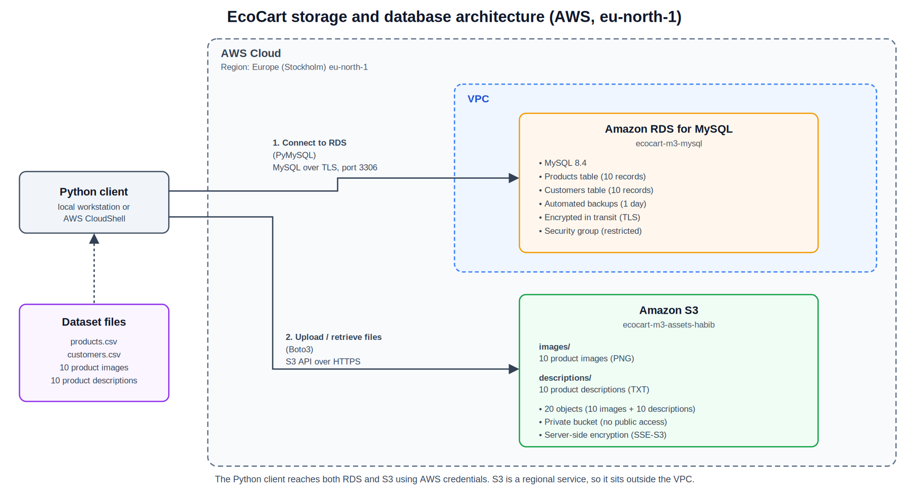

# EcoCart — Storage and Database Solution on AWS

**Modular Assignment 3 | Cloud Computing**  
**Author:** Md Habib Ahmed  
**AWS Region:** Europe (Stockholm), `eu-north-1`  
**Status:** Completed academic demonstration. The RDS database was subsequently deleted as part of cost cleanup; this repository preserves the implementation files and evidence. **There is no live database endpoint.**

EcoCart demonstrates cloud object storage and a relational database for a sample e-commerce product catalogue. **Amazon RDS for MySQL** stored structured product and customer records, while **Amazon S3** held product images and text descriptions. Python scripts were used to generate sample data, import CSV records into MySQL, and verify S3 objects using `boto3`.

**This is an academic infrastructure demonstration, not a deployed online store.** The AWS resources were configured and tested through the AWS Console and Python tools; the repository contains source files, sample datasets, architecture, evidence, and the assignment report.

## Architecture



[View the full-resolution architecture diagram](docs/EcoCart-M3-Architecture.png)

The architecture shows a Python client connecting separately to **RDS MySQL over TLS (port 3306)** and **S3 over HTTPS using boto3**. RDS runs within a VPC; S3 is a regional AWS service outside the VPC. Product records contain S3 object keys, but the database does not directly connect to the bucket. The MySQL connection uses database credentials; S3 requests use AWS credentials available in the execution environment.

## Project contents

| Location | Purpose |
|---|---|
| [`data/products.csv`](data/products.csv) | Sample catalogue records for 10 products |
| [`data/customers.csv`](data/customers.csv) | Sample records for 10 fictional customers |
| [`data/images/`](data/images/) | 10 generated product images (`P001.png`–`P010.png`) |
| [`data/descriptions/`](data/descriptions/) | 10 product text descriptions (`P001.txt`–`P010.txt`) |
| [`database/schema.sql`](database/schema.sql) | MySQL schema for the `products` and `customers` tables |
| [`database/rds-ca-bundle.pem`](database/rds-ca-bundle.pem) | RDS CA certificate bundle used for TLS verification |
| [`scripts/generate_datasets.py`](scripts/generate_datasets.py) | Generate sample CSV datasets |
| [`scripts/generate_descriptions.py`](scripts/generate_descriptions.py) | Generate product descriptions |
| [`scripts/generate_images.py`](scripts/generate_images.py) | Generate product images |
| [`scripts/import_to_rds.py`](scripts/import_to_rds.py) | Import CSV records into RDS MySQL using PyMySQL |
| [`scripts/verify_s3.py`](scripts/verify_s3.py) | Verify and retrieve S3 objects using boto3 |
| [`docs/EcoCart-M3-Architecture.png`](docs/EcoCart-M3-Architecture.png) | AWS architecture diagram shown above |
| [`docs/evidence/`](docs/evidence/) | AWS deployment, validation, security, and backup screenshots |
| [`docs/Storage and Database Solution-M3-Report.docx`](docs/Storage%20and%20Database%20Solution-M3-Report.docx) | Final submitted Modular Assignment 3 report |

## AWS configuration

| Component | Implemented configuration |
|---|---|
| Region | `eu-north-1` — Europe (Stockholm) |
| Amazon RDS | MySQL 8.4; instance `ecocart-m3-mysql` |
| Database | `ecocart_db` |
| Tables | `products` and `customers`, 10 records each |
| RDS access | MySQL port 3306 restricted to an authorized client IP by a security group |
| Transport security | TLS connection validated using the AWS RDS CA bundle |
| RDS backups | Automated backups enabled, 1-day retention; snapshot availability verified |
| Amazon S3 | Bucket `ecocart-m3-assets-habib` |
| S3 object layout | `images/` (10 PNG) and `descriptions/` (10 TXT) |
| S3 security | Block Public Access; default SSE-S3 encryption |

These settings describe the **tested deployment**, not resources guaranteed to remain active today.

## Database design

The SQL schema is available at [`database/schema.sql`](database/schema.sql).

- **`products`:** `product_id` (primary key), `name`, `category`, `price`, `stock`, `image_s3_key`, `description_s3_key`.
- **`customers`:** `customer_id` (primary key), `name`, `email` (unique), `city`.

The schema uses constraints for nonnegative prices and stock quantities. Customer data is fictional. The image and description columns store **S3 object keys**, rather than image binaries or description documents in MySQL.

## Python integration and verification

### 1. Import CSV data into RDS

The [`import_to_rds.py`](scripts/import_to_rds.py) script uses **PyMySQL** and a TLS-verified connection. It prompts for the endpoint and database credentials rather than hardcoding secrets. It supports reruns through upsert statements.

```bash
python -m pip install pymysql
python scripts/import_to_rds.py
```

**Recorded output:**

```text
Products in RDS: 10
Customers in RDS: 10
CSV import completed successfully.
```

The RDS instance has been deleted, so these commands are provided for documentation only; running them again would require a new database and appropriate network access.

### 2. Verify S3 objects

The [`verify_s3.py`](scripts/verify_s3.py) script uses **boto3** to list objects and retrieve `descriptions/P001.txt`. It was tested in AWS CloudShell with configured AWS credentials.

```bash
python3 -m pip install boto3
python3 scripts/verify_s3.py
```

**Recorded result:** 10 PNG product images and 10 TXT descriptions verified; a sample text object was retrieved successfully. The script must be made available in CloudShell before it can be run there.

## Validation results

| Test | Recorded result |
|---|---|
| RDS MySQL deployment and schema creation | Passed |
| Import product CSV data | Passed — 10 records |
| Import customer CSV data | Passed — 10 records |
| Verify database row counts | Passed — 10 records in each table |
| Verify S3 product images | Passed — 10 PNG objects |
| Verify S3 descriptions | Passed — 10 TXT objects |
| Retrieve sample S3 description using boto3 | Passed |
| Confirm RDS automated backup settings | Verified — 1-day retention and available snapshot |

[View AWS screenshots and validation evidence](docs/evidence/)

## Security, backup, and limitations

- **Database network security:** RDS MySQL access was restricted to the authorized client IP for testing, rather than open to the entire internet.
- **Encryption in transit:** The Python MySQL connection used TLS with certificate verification.
- **S3 protection:** Public access was blocked, with default SSE-S3 encryption enabled.
- **Backup configuration:** RDS automated backups and a snapshot were verified; an actual database restore was **not** demonstrated.
- **Scope:** RDS and S3 were tested through **separate Python workflows**. No hosted storefront, production API, multi-AZ deployment, or single end-to-end transaction spanning both services was implemented.
- **Credentials:** No database passwords or AWS access keys are intentionally included in this repository.

## Assignment evidence and documentation

- [Final Modular Assignment 3 report (DOCX)](docs/Storage%20and%20Database%20Solution-M3-Report.docx)
- [EcoCart AWS architecture diagram](docs/EcoCart-M3-Architecture.png)
- [AWS evidence screenshots](docs/evidence/)
- [MySQL schema](database/schema.sql)
- [Python implementation scripts](scripts/)
- [Sample product and customer datasets](data/)

## Cost management and project status

After the assignment demonstration, the **RDS database was deleted** to prevent further instance usage charges. Remaining S3 objects, retained backups or snapshots (if any), and other AWS resources should be reviewed and removed when no longer needed. AWS billing data may take time to update.

This repository is retained as a record of the completed educational assignment. It does **not** provide a live AWS service or production application.
